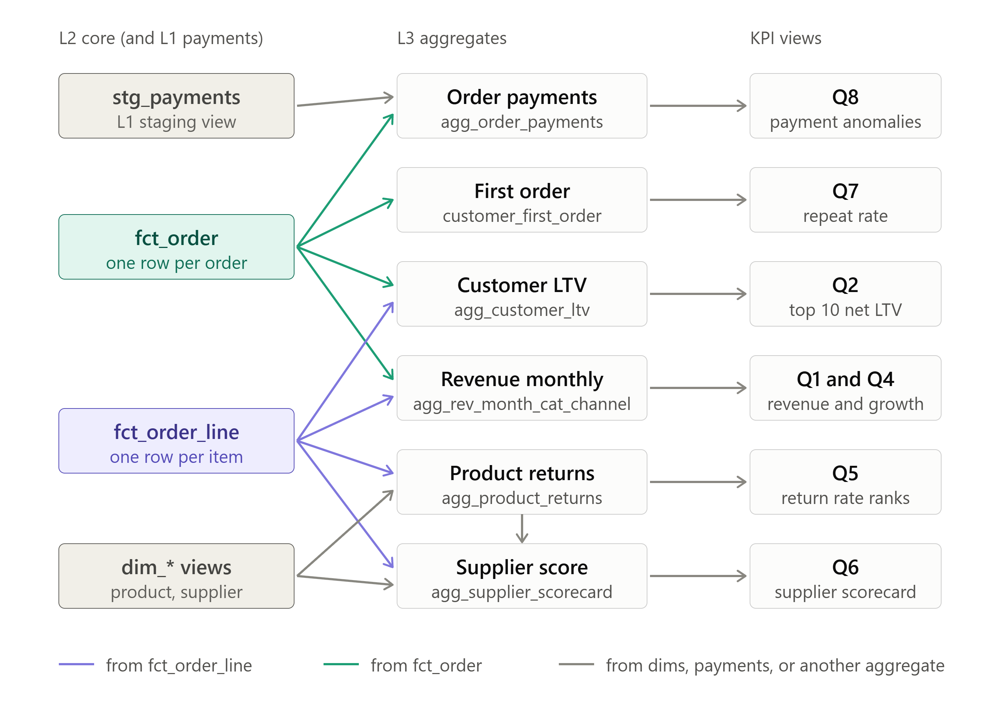

# KPI layers: L1 to L3 schemas

## Lineage map

<!-- Replace the line below with your image, for example:  -->

## Map notes

The L1-to-KPI map leaves some dependencies off to keep it readable:

- `dim_product` feeds the Revenue aggregate (for category). The Margin Risk report reads it together with `fct_order_line`. That report has no box on the map.
- Q3 (segments) also reads `fct_order` for average order value.
- `stg_payments` skips L2 and goes straight to the order payments aggregate, as does the `fct_order` arrow there.

## L1 staging (views)

Raw columns are kept except personal details (names, email, phone, address), which stay in the raw layer. Added or cleaned columns have a suffix or flag.

| Table | Columns |
|---|---|
| `stg_orders` | order_id, customer_id, order_date, order_status_std, channel_std, payment_method, promo_code, shipping_city |
| `stg_order_items` | order_item_id, order_id, product_id, quantity, unit_price, discount_pct, line_total, line_net, line_total_mismatch |
| `stg_products` | product_id, product_name, category_std, sub_category, unit_price, cost_price, supplier_id, is_active, launch_date |
| `stg_customers` | customer_id, city, state, signup_date, segment_std, is_active |
| `stg_suppliers` | supplier_id, supplier_name, country, rating_norm, is_preferred |
| `stg_returns` | return_id, order_item_id, return_date, refund_amt_capped, return_status_std |
| `stg_payments` | payment_id, order_id, payment_date, amount, payment_status_std, payment_method, is_exact_duplicate |

## Mapping tables

| Table | Columns | Feeds |
|---|---|---|
| `map_category` | raw_label, category_std | `stg_products` |
| `map_channel` | raw_label, channel_std | `stg_orders` |
| `map_segment` | raw_label, segment_std | `stg_customers` |
| `map_order_status` | raw_label, status_std | `stg_orders` |

## L2 core

| Table | One row per | Columns |
|---|---|---|
| `fct_order` | order | order_id, customer_key, order_date, order_month, status_std, channel_std, net_amt, is_completed |
| `fct_order_line` | order item | order_item_id, order_id, product_id, qty, unit_price, line_net, cost_amt, line_total_mismatch, returned_qty, refund_amt, net_after_refund |
| `agg_returns_by_item` | order item with returns | order_item_id, return_count, returned_qty, refund_amt |
| `dim_product` | product | product_id, product_name, category_std, sub_category, cost_price, supplier_id, is_active |
| `dim_customer` | customer | customer_id, city, state, signup_date, segment_std, is_active |
| `dim_supplier` | supplier | supplier_id, supplier_name, country, rating_norm, is_preferred |

## L3 aggregates

| Table | One row per | Columns |
|---|---|---|
| `agg_rev_month_cat_channel` | month x category x channel | order_month, category_std, channel_std, units, line_net, refund_amt, net_revenue |
| `agg_customer_ltv` | customer | customer_key, completed_orders, net_ltv, last_order_date, ltv_rank |
| `customer_first_order` | customer | customer_key, first_completed_date, orders_within_90d, is_repeat_90d |
| `agg_product_returns` | product | product_id, ordered_qty, returned_qty, return_rate, meets_min_volume |
| `agg_supplier_scorecard` | supplier | supplier_id, revenue, avg_return_rate, rating_norm, composite_score |
| `agg_order_payments` | order | order_id, order_total, paid_amt, success_payment_count, duplicate_count, no_success_flag, anomaly_type |

## Open decision

The product dedupe rule is still for the business to settle: latest `launch_date`, active flag, or the row matching `order_items.unit_price`. It determines which row survives in `stg_products`, so it should be settled before the DDL.
